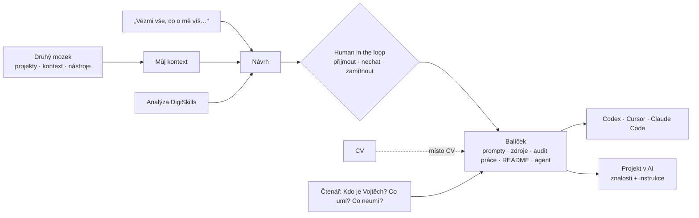

# Whiteboard: textový přepis kresby

Kresba, kterou vypráví video, je jako fotka v [`whiteboard.jpg`](whiteboard.jpg). Tady je přepsaná textem, aby ji přečetla i AI. **Na tabuli** = co tam opravdu stojí. **Co to znamená** = můj výklad.

## 1. Druhý mozek a kontext (vlevo)

**Na tabuli:**
- Postavička s dokumentem → šipka → kruh „AI“ (Copilot, ChatGPT, Claude).
- Druhá postavička u rámu „DRUHÝ MOZEK“: propojené poznámky, vedle „Projekty, Kontext, Nástroje“, pod rámem „+ Agenti, + Skilly“.
- Pod AI pyramida: PROMPT (nahoře, nejmenší) / KONTEXT / MODEL (základ).
- Citát: „Vezmi vše, co o mě víš, a zpracuj z toho aplikační balíček, který pošlu místo CV.“

**Co to znamená:** dva způsoby práce s AI. Buď jí pokaždé nesete dokument, nebo AI čte váš druhý mozek, tedy uspořádaný kontext vaší práce. Prompt je jen špička, kvalitu nese kontext a model pod ním. Citát je skutečné zadání, kterým tahle přihláška začala.

## 2. Návrh a human in the loop (střed)

**Na tabuli:**
- Dokumenty „Můj kontext“ a „Analýza DigiSkills“ → šipky → box „Návrh“.
- Pod návrhem: 1.) ✓ · 2.) – · 3.) – · 4.) ✗
- Postavička v kruhové šipce: „Human in the loop“.
- Rám „Git“: Prompty, Zdroje, Audit práce, README a zvýrazněný box Agenti. Vedle přeškrtnuté CV.
- Čtenář se ptá agenta: „Kdo je Vojtěch a co dělá?“ „Co umí?“ „Co neumí?“

**Co to znamená:** AI z kontextu a analýzy navrhla, já jsem návrhy třídil: něco přijal, něco nechal, něco zamítl. Výsledkem není CV, ale balíček, kterého se dá ptát. Konkrétní zamítnutí jsou v `audit-prace.md`, sekce Co jsem přehlasoval.

## 3. Jak balíček otevřít (vpravo)

**Na tabuli:**
- „Git balíček“ → „Codex, Cursor, CC“ (CC = Claude Code).
- „Git balíček“ → „znalosti – balíček“ a pod tím „instrukce“.

**Co to znamená:** dvě cesty. Otevřít celou složku v nástroji, který pracuje se soubory (Codex, Cursor, Claude Code). Nebo ji nahrát do projektu v chatové AI: soubory jsou znalosti, instrukce je text z `handover-agent.md`.

## Tok jedním diagramem

